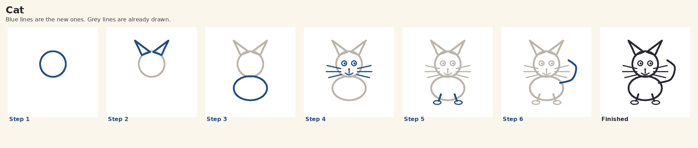

# Draw With Me

Draw With Me is a Mac app for a child of about 9. She types a word, such as **cat**, and the app shows a simple pen drawing plus the steps to copy it on paper. Each step adds a few lines. New lines are blue. Lines she already drew are grey.

The pictures are not generated. They are a book of 90 drawings stored on the Mac. The app does not use the internet.



## Download and install

When a release is published, download the universal Mac app (Apple silicon and Intel) from:

https://github.com/matjns/kids-drawing/releases

The file is named `Draw With Me-mac-universal.zip`. It contains `Draw With Me.app` and `README-mac.txt`.

macOS may refuse to open an unsigned app. `README-mac.txt` explains Control-click → Open, and the `xattr -cr` command if the quarantine flag is stuck. The app needs macOS 14 or newer.

You can also build it yourself on a Mac. See below.

## How to use it

1. Type a word and press Return, or press **Draw**.
2. Copy the blue lines. Press **Next** for the next lines.
3. **Show the finished drawing** shows every line in ink.
4. **I drew it!** remembers that drawing on this Mac.
5. **Surprise me** picks a subject. **All drawings** is the picture grid, and the chips filter by category.

Nicknames and small mistakes work: `kitty`, `kittens`, and `kat` open the cat. `puppy` opens the dog. `aeroplane` opens the airplane. A word the book does not have, or a word we will not draw, gets **Let's try another one!** and three ideas. Nothing rude is shown.

Command-Left and Command-Right move between steps. Command-R is Surprise me. Command-F jumps to the word box. Closing the window quits the app. Command-Q quits it too.

Finished drawings are saved in `~/Library/Application Support/Draw With Me/`. There is no account and no player name.

## Kids Computer launcher

The Kids Computer launcher starts this app with the bundle id `com.kidscomputer.drawing`. Draw With Me is a normal Mac app: it does not hide the Dock or take over the menu. When its window closes, it quits, so the launcher can show again.

## The drawing book

Subjects are animals, fantasy (dragon, unicorn, crown, wand), vehicles, food, nature, space, buildings, and everyday things. The format is JSON with SVG-style paths, one step at a time. How to add another subject is in [docs/DRAWING_FORMAT.md](docs/DRAWING_FORMAT.md).

Line-art checks, drawn on Linux from those paths, are in [docs/screenshots/](docs/screenshots/).

## Build and test

Logic tests (the word matcher, the path parser, the lesson steps, and the whole drawing book) run anywhere Swift is installed, including Linux:

```bash
./build.sh test
```

The Mac app itself builds only on a Mac:

```bash
./build.sh
```

That produces `dist/Draw With Me.app` and `dist/Draw With Me-mac-universal.zip`.

GitHub Actions (`.github/workflows/macos.yml`) runs the tests and the universal build on every push. A version tag such as `v1.0.0`, or a manual run of the workflow, publishes the zip as a GitHub Release.

To regenerate the pictures after editing the book:

```bash
python3 tools/generate_drawings.py
python3 tools/render_previews.py
```

## App Store

What is left to submit (signing, the installer package, the privacy label) is in [docs/APP_STORE.md](docs/APP_STORE.md). The privacy label is **Data Not Collected**.

## Privacy

No network. No accounts. No ads. No analytics. No links out of the app. Progress stays on this Mac.

## License

MIT. Copyright 2026 matjns. See [LICENSE](LICENSE).
